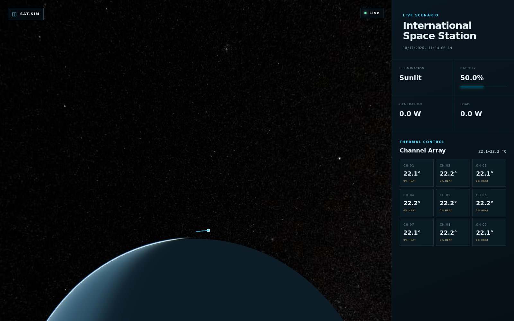

# sat-sim

A small, runnable Python starter application with a simple entity-component-system (ECS).

## Requirements

- Python 3.12 or newer
- [uv](https://docs.astral.sh/uv/)

## Setup

Create the virtual environment and install the development dependencies:

```shell
uv sync
```

The project includes `pyorbital` for orbital propagation and `numpy`, `scipy`,
and `pyproj` transitively for its calculations.

## Run

Run the starter application:

```shell
uv run python -m sat_sim
```

or with the installed console script:

```shell
uv run sat-sim
```

Run the live ISS scenario. It fetches the current ISS TLE from CelesTrak,
then prints the propagated ECI position, velocity, and nine-channel thermal
telemetry once per step:

```shell
uv run python -m sat_sim.scenarios.iss_scenario
```

The ISS scenario initializes nine heaters and paired sensors in a 3x3 grid,
automatically applies PID control when a sensor falls below the 22 °C threshold,
advances the thermal simulation using elapsed wall-clock seconds, and prints
each channel's temperature, heater output/power, threshold, and illumination
alongside the orbital state. These thermal defaults are
illustrative rather than a validated spacecraft thermal model.

The simulation runs continuously until you press `Ctrl+C`. `Simulation.run()`
handles `KeyboardInterrupt` internally and returns when stopped. It fetches
the TLE once during `ISSScenario.setup()`, reuses one orbital propagator, and
uses a monotonic clock to avoid accumulating drift. The ISS scenario requires
network access; its HTTP request has a 10-second timeout, and transient network
errors are retried twice with a one-second delay between attempts.

## Scenario architecture

A `Scenario` is an abstract ECS-backed unit with two lifecycle methods:

- `setup(timestamp)` creates entities and initializes scenario-specific state.
- `step(timestamp)` advances the scenario and returns the state to report.

`Simulation` owns scheduling and accepts a `Scenario` in its constructor. This
keeps timing independent from scenario setup and allows other scenarios to reuse
the same one-second scheduler:

```python
from sat_sim.scenarios.iss_scenario import ISSScenario
from sat_sim.simulation import Simulation

simulation = Simulation(ISSScenario())
simulation.run()  # returns when interrupted with Ctrl+C
```

The ISS-specific class fetches its TLE and creates its ECS entity in `setup()`;
`Simulation` calls `step()` at each scheduled tick.

## Attitude determination and control

`ISSScenario` uses the rigid-body ADCS model in `sat_sim.adcs` instead of
instantaneously forcing the ideal orbital frame. Its body-to-ECI quaternion and
body angular velocity are integrated from Euler's rotational equation with
configurable principal moments of inertia. A quaternion-error PD controller
tracks a nadir reference where body +Z points toward Earth and body +X follows
the projected along-track velocity.

Three orthogonal reaction wheels apply equal-and-opposite spacecraft torque.
Each wheel enforces motor-torque and rotor-speed limits and reports its speed
and saturation state. The default integrator subdivides scenario steps into at
most 0.1 second intervals and normalizes the quaternion after every substep.
The initial state is aligned with the current nadir frame and initialized at
the orbital-frame angular rate. These parameters are illustrative spacecraft
values, not validated ISS hardware values.

The dynamics also accept independently testable environmental-torque models.
The ISS scenario enables a point-mass Earth gravity-gradient model by default;
pass `gravity_gradient_enabled=False` to `ISSScenario` to disable it. The model
uses SI units and evaluates `3 μ/r³ (r̂ × I r̂)` in spacecraft body axes on
every integration substep.

An aerodynamic-drag torque model is also enabled by default and can be disabled
with `aerodynamic_drag_enabled=False`. It subtracts a co-rotating atmosphere's
velocity from the ECI spacecraft velocity, evaluates a constant-density drag
force, transforms that force into body axes, and applies it at a configurable
center-of-pressure offset. Its default density, area, and geometry are
illustrative rather than an ISS atmosphere or structural model.

Solar-radiation-pressure and residual-magnetic-dipole torques complete the
initial disturbance set. SRP uses the existing Sun/eclipse model and a fixed
body-frame center-of-pressure offset. The magnetic model uses a centered axial
Earth dipole and a configurable fixed spacecraft residual dipole. Disable them
with `solar_radiation_pressure_enabled=False` and
`residual_magnetic_dipole_enabled=False`, respectively.

The scenario owns ADCS scheduling: orbit propagation, reference/control,
rigid-body integration, thermal dynamics, and finally electrical accounting.
Thermal and power systems consume the completed attitude without changing it.
Standalone `ThermalControlSystem` users retain the legacy ideal
`AttitudeSystem` behavior unless they supply their own fixed attitude.
Telemetry includes body rates, target quaternion, pointing error, commanded,
applied, and disturbance torque, wheel speeds, and wheel saturation. The ADCS
also contributes an 8 W default idle electrical load.

The scenario installs an illustrative gyro, Sun sensor, magnetometer, and Earth
vector sensor. Their bias, drift, noise, and validity can be configured through
`ADCSSensorConfiguration`. A deterministic complementary estimator integrates
gyro measurements and corrects the quaternion with whichever vector sensors
are valid; the controller uses this estimate rather than truth state. Estimated
attitude, measured body rate, and sensor-valid flags are included in telemetry.

`ADCSModeState` supports nadir pointing, inertial hold, Sun pointing, safe mode,
and magnetic detumble. Losing the gyro or every absolute-vector sensor causes
automatic safe-mode entry and publishes a fault reason. A three-axis limited
magnetorquer damps body rates in detumble mode and counters reaction-wheel
unloading torque whenever wheel speed exceeds the configured momentum threshold.
Mode, fault, commanded dipole, and magnetic torque are exposed in telemetry.

## Thermal control system

`ThermalControlSystem` provides nine paired temperature sensors and heaters by
default. Pairs occupy a row-major 3x3 grid with one meter between neighbors;
smaller channel counts use the first cells. Each channel is stored as a thermal
node entity in an ECS `World`, with `TemperatureSensor`, `Heater`,
`HeaterCommand`, and `PIDState` components. The spacecraft illumination state is
stored on its ECS entity as `IlluminationState`. In `ISSScenario`, orbital and
thermal entities share the scenario's `World`.

The attitude helpers live in `sat_sim.attitude`. Outside the integrated ISS
scenario, the TCS facade runs ideal attitude, illumination, heater control, and
thermal dynamics in that order. If no ECI velocity is present, the frame remains
fixed (identity by default). Set `auto_orient=False` to supply a fixed frame.
Scenario telemetry is read from ECS queries into an immutable snapshot. The
compatibility `sensors` and `heaters` properties return channel-ordered views;
new code should query the ECS world directly.

Each sensor below the configured temperature threshold automatically drives its
paired heater with a bounded PID controller (`kp=1.0`, `ki=0.0`, `kd=0.0` by
default):

```python
from datetime import UTC, datetime

from sat_sim.services.tcs import ThermalControlSystem

tcs = ThermalControlSystem(
    sensor_count=9,
    wattages=[10.0] * 9,
    heater_threshold_celsius=22.0,
    kp=0.1,
)
# Runs illumination, heater-control, then thermal-dynamics systems.
tcs.step(1.0, (6_700_000.0, 0.0, 0.0), datetime.now(UTC))

# Manual full-power operation remains available:
tcs.activate_heater(1)
tcs.step(1.0, (6_700_000.0, 0.0, 0.0), datetime.now(UTC))
tcs.deactivate_heater(1)
```

To model sensors on different faces, pass one body-frame normal per channel,
for example `sensor_normals_body=[(1, 0, 0), (-1, 0, 0)]` with
`sensor_count=2`. Opposing faces cannot both receive direct sunlight at the
same instant. The normals are normalized when sensors are created.

A PID output is clamped to 0–100% of the heater's rated wattage. Its derivative
is based on measured temperature (avoiding setpoint kick), and integral
accumulation uses conditional anti-windup. In automatic mode, each heater
uses the shared threshold; manual activation overrides PID at full power until
deactivated. `set_setpoint(index, target_celsius)` selects an explicit per-heater
PID target instead, while `deactivate_heater(index)` turns it off and suppresses
automatic control until `enable_automatic_control(index)` is called.

The TCS accepts the satellite's Earth-centered inertial position on every step.
It estimates the Sun direction from UTC time, treats Earth as a spherical
6,371 km opaque body, and classifies the spacecraft as eclipsed when it lies
behind Earth inside a cylindrical umbra. It ignores penumbra, atmosphere, and
all other celestial bodies. Each sensor has a unit normal in the spacecraft body
frame (`sensor_normals_body` in the constructor); the default is body +Z for all
nine sensors, modeling one planar grid. In sunlight, solar warming is scaled by
`max(0, normal_ECI · sun_direction_ECI)`, so a sensor turned away from the Sun
receives no direct solar heat. In eclipse, all sensors cool. The default maximum
sun-facing warming rate is 0.02 °C/s and eclipse cooling is 0.01 °C/s; both are
configurable. This is an illustrative direct-solar model, not a full radiative
heat-transfer simulation. Each heater independently runs PID while
its paired sensor is strictly below `heater_threshold_celsius` (22 °C by
default), otherwise it turns off. Set the threshold to `None` to disable
automatic heater control.

The intentionally simple thermal model applies each heater's contribution to
every sensor. For distance `d` in meters, its contribution is multiplied by
`1 / (1 + ln(1 + d))`; the paired sensor is at `d=0` and gets full contribution.
Temperature change is `wattage * PID_output_fraction * heating_rate * delta_time *
attenuation`. `heating_rate` is the temperature-rise scale per watt-second,
temperature is in degrees Celsius, and time is in seconds. This logarithmic
attenuation is a qualitative grid interaction model, not a physical heat
diffusion solver. `grid_spacing_m` and the channel count (1–9) are configurable.

## Power control and distribution

The ISS entity has `PCDU` and `SolarPanel` components. `PCDUSystem` converts
panel incidence into generated power with
`peak_power_w * max(0, panel_normal_ECI · sun_direction_ECI)` and produces no
power while the spacecraft is in Earth's eclipse. Net watt-seconds are
converted to watt-hours and applied to the battery, clamped between empty and
its configured capacity.

Spacecraft loads expose a `PowerConsumer` component. Each TCS heater updates its
requested power from its rated wattage and PID output, and ADCS contributes its
idle load, before the PCDU totals all consumers. The ISS scenario reports
battery charge, generated power, and consumed power on every step. The defaults
are a 1,000 Wh battery initially charged to 500 Wh and a 100 W panel mounted on
body -Z; these values are configurable in the `ISSScenario` constructor.

## Frontend telemetry API

The separate `sat_sim_telemetry` package adapts simulation state for browser
frontends without adding transport concerns to `sat_sim`. It provides immutable,
versioned Pydantic wire models and a FastAPI application with:

- `GET /api/v1/scenario` for static units, geometry, and capacities;
- `GET /api/v1/state` for the latest complete state snapshot; and
- `WS /api/v1/telemetry` for timestamped state frames.

Frames contain ECI position and velocity, a normalized body-to-ECI quaternion,
Sun/eclipse state, PCDU telemetry, and all thermal channels. Field names use
lower camel case on the wire. The broadcaster keeps only a small bounded queue
per client, so a slow renderer receives recent simulation state instead of
creating backpressure.

The live server also produces a CRC-protected PUS Service 3 periodic
housekeeping packet (`TM(3,25)`) for every simulation step. Complete PUS packets
are published and consumed exclusively as one packet per UDP datagram; they are
not exposed through the HTTP telemetry API. Its application payload uses the
PUSUtilities `DataSST25` layout implemented by `HousekeepingReport`: an 8-bit
structure ID followed by raw parameter values in the structure order configured
in PUSUtilities. Parameter IDs and types are mission-database metadata and are
not repeated in each report. The CCSDS packet sequence counter carries the
simulation report sequence.

TCS parameter IDs, sizes, types, and source PRID come from `plugin_tcs`'s
`TCS.java` on its `dev` branch: PRID 5, 27 four-byte `FLOAT` thermistors grouped
as three sensors for each of nine heaters, followed by nine four-byte `INTEGER`
heater indicators. Each simulated thermal channel feeds the plugin's three
thermistors for that heater. Heater output is published as the integer activity
indicator expected by the plugin. SID 1 must be configured in PUSUtilities with
those 36 IDs in the order declared by `TCS_HOUSEKEEPING_DEFINITIONS`; the plugin
registers their value metadata but does not create a housekeeping structure.
Illumination and electrical-power values are omitted because `plugin_tcs`
defines no parameter IDs for them.
Service 3 definition-management telecommands are not implemented yet.

The bidirectional UDP socket is configured through environment variables:

- `SAT_SIM_PUS_BIND_HOST` and `SAT_SIM_PUS_BIND_PORT` select the local receive
  address (defaults: `127.0.0.1:10025`);
- `SAT_SIM_PUS_DESTINATION_HOST` and `SAT_SIM_PUS_DESTINATION_PORT` select the
  publish destination (defaults: `127.0.0.1:10015`).

Inbound datagrams are parsed as complete PUS source packets and discarded when
their framing or CRC is invalid. Valid packets enter the service-dispatch path;
Service 3 management telecommands are the next planned consumer.

```python
from sat_sim.scenarios.iss_scenario import ISSScenario
from sat_sim_telemetry import TelemetryStore, create_app, describe_iss_scenario

scenario = ISSScenario()
store = TelemetryStore()
app = create_app(store, lambda: describe_iss_scenario(scenario))
```

Use `ISSTelemetryPublisher` to step the scenario and publish each resulting
frame. A Cesium client can feed the timestamped ECI samples into a
`SampledPositionProperty` and use the supplied quaternion for orientation.

## Cesium frontend

The separate `frontend` package renders the live ISS position and orbit trail
over Esri World Imagery on a Cesium globe, with source attribution displayed on
the map. It transforms timestamped ECI samples into Cesium's fixed frame,
applies the streamed body-to-ECI attitude, and shows eclipse, battery,
generation, load, ADCS pointing error, reaction-wheel speed, and all nine
thermal channels in a responsive systems panel.



Start the live simulation API and the frontend in separate terminals:

```shell
uv run sat-sim-telemetry
cd frontend && npm install && npm run dev
```

Then open `http://127.0.0.1:5173`. Vite proxies both HTTP and WebSocket API
traffic to `http://127.0.0.1:8000`, so no Cesium ion token is required. The Esri
imagery service requires network access from the browser. To use
a custom development hostname, set a comma-separated allowlist before starting
Vite, for example `VITE_ALLOWED_HOSTS=dashboard.example.test npm run dev`. The
client reconnects automatically with bounded exponential backoff if the
telemetry server restarts.

## PUS library (Python port)

`pus_library` ports the Java library's PUS packet primitives into a Python
module: packet identifiers and primary headers, TC/TM data-field headers, CUC
time, time-sync quality, packet payload containers, source-packet creation and
parsing, and CRC-16/CCITT-FALSE validation. Supported service type/subtype
metadata is available through `service_data`; service payloads are retained as
opaque bytes so service-specific application formats can be added without
changing packet framing.

```python
from pus_library import SourcePacket, service_data

ping = service_data(17, 1)  # TC(17,1)
packet = SourcePacket.get_source_packet(ping, local_prid=1, destination_prid=100)
wire_bytes = packet.get_bytes()
assert packet.verify_crc()
received = SourcePacket(wire_bytes, SourcePacket.DEFAULT_BYTE_ORDER)
```

The port's wire-format and regression tests are in `tests/test_pus_library.py`.
The original Java JUnit suite is separate in the source library checkout; its
Maven configuration skips tests by default, so run it explicitly with
`mvn test -DskipTests=false`.

## ECS example

Create a world, add a satellite with an ECEF position, and advance it with the
movement system. Positions use Earth-Centered, Earth-Fixed Cartesian coordinates
in meters. Velocities use the corresponding ECEF frame in meters per second.

```python
from sat_sim.ecs import World
from sat_sim.position import Position
from sat_sim.simulation import Velocity, create_satellite

world = World()
satellite = create_satellite(world, Position(6_700_000, 0, 0), Velocity(0, 7_500, 0))

print(world.get(satellite, Position))
# Position(x=6700000.0, y=3750.0, z=0.0)
```

`World` supports entity creation and destruction, component add/get/remove/has
operations, and type-based queries:

```python
for entity, position, velocity in world.query(Position, Velocity):
    print(entity, position, velocity)
```

## pyorbital ECI adapter

The orbital adapter accepts an existing `pyorbital.Orbital` object. It does not
load TLE data or convert coordinate frames. Pyorbital's propagated ECI output is
converted from kilometers and kilometers per second into meters and meters per
second, then stored in `ECIPosition` and `ECIVelocity` components.

```python
from datetime import datetime, timezone

from pyorbital.orbital import Orbital
from sat_sim.ecs import World
from sat_sim.orbital import ECIPosition, create_satellite_from_orbital

orbital = Orbital("satellite", tle_file="path/to/tle.txt")
world = World()
satellite = create_satellite_from_orbital(
    world,
    orbital,
    datetime.now(timezone.utc),
)

print(world.get(satellite, ECIPosition))
```

## Test

```shell
uv run pytest
```

## Quality checks

Format the project:

```shell
uv run ruff format .
```

Check lint, formatting, types, and coverage:

```shell
uv run ruff check .
uv run ruff format --check .
uv run mypy
uv run pytest  # runs with coverage; fails below 90%
```
